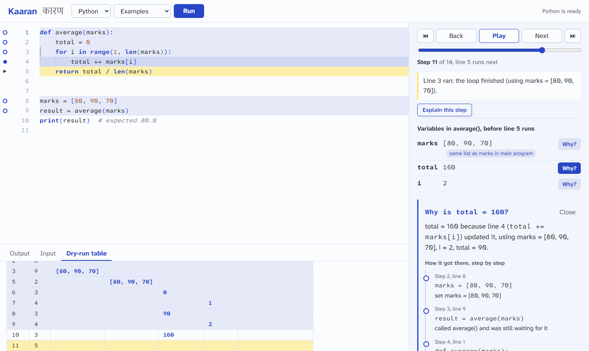

# Kaaran

> Know why your code does what it does. (*kaaran*, कारण: "cause")

Kaaran is a debugging tutor for beginner programmers. Paste a program, step through it line by line, and press **Why?** next to any variable: Kaaran traces the value back to the lines that caused it and explains the chain in plain words.



*In the picture, `average([80, 90, 70])` prints 53.33 instead of 80. Asking why `total` is 160 marks the lines that caused it, including the loop `range(1, len(marks))`, which skips the first mark.*

**Demo:** https://devrajrawat9027562124-web.github.io/kaaran/ (works once GitHub Pages is turned on, see below)

## What it does

- **Step through Python, C and C++**, forward and back, with the current line highlighted, the variables before each line, the call stack and the output.
- **Why?** on any variable or output line: a *dynamic backward slice* over the run, shown as marked lines plus a cause chain you can click through.
  - "b and a are the same list, so changing a also changes b"
  - "changed x through p: p points to x"
  - "the condition was False (using n = 4)"
- **Memory view**: linked lists, trees and objects drawn as boxes and arrows (a BST in sorted order), with freed memory marked. It works for `malloc`'d structs in C and objects in Python.
- **Programs that read input (`scanf`, `input()`, menus)**: press Run and the program first runs in the **Terminal**, like a normal compiled program: you type each value when it asks. When it finishes, press **Explain this run** and Kaaran steps through exactly that run, with your input. (Or give all the input up front in the Input tab.)
- **Each change is shown as it happens**: the line that just ran gets a note in the editor (`total: 90 → 160`, `→ False`, `printed 3`), changed variables show the old value crossed out, new heap nodes and arrows are drawn in, and new output lines are marked. Play runs slow, normal or fast. All motion is off when the system asks for reduced motion.
- **Dry-run table**: the trace table students draw on paper, one row per line run, with columns grouped by function and new values only (or every value). It fills in as you step: a line that calls a function fills in once the call returns. In C/C++ a variable declared without a value is written `?` until something sets it. Click a value to ask why; copy or download it as CSV.
- **Explain this step** (optional): Claude explains the step in plain words. Every value it mentions is checked against the trace, and wrong ones are flagged.
- **Accounts (optional)**: a home page, log in and sign up. With an account you can save programs and open them again later; without one, everything else works the same ("Continue as guest"). Accounts are kept by the backend in SQLite, with scrypt-hashed passwords.
- **Safe by design:** Python runs in the browser (Pyodide) and endless programs are stopped. C/C++ runs in a locked-down Docker container.

## How it works

```
Browser: React UI + Pyodide worker ── tracer.py (Python) ─┐
                                                          ├─► one trace format ─► Why Engine (why.py)
Backend: FastAPI ─► Docker ─► c_tracer.py (GCC + GDB) ────┘
```

Every language produces the same step-by-step trace (`docs/trace-format.md`), and the Why Engine works on that trace alone, so it explains Python and C/C++ with the same code. Details and limitations are in **`docs/design.md`**.

## Run it

**Frontend** (Python works fully here):

```
cd frontend
npm install
npm run dev          # http://localhost:5173
```

**Backend** (needed for C/C++ and for "Explain this step"):

```
cd backend
python -m venv .venv
.venv\Scripts\activate          (Linux/macOS: source .venv/bin/activate)
pip install -r requirements.txt
copy .env.example .env          (then edit it)
docker build -t kaaran-runner runner
uvicorn app:app --port 8000
```

Without Docker, `KAARAN_SANDBOX=local` in `.env` runs C/C++ with your own gcc/gdb, for development on your own code only. The explainer needs `ANTHROPIC_API_KEY` in `.env`, and its usage is billed to your account. See **`backend/README.md`** for the sandbox's security model.

**Tests:**

```
pip install pytest -r backend/requirements.txt -r backend/runner/requirements.txt
python -m pytest tests -v       # C/C++ tests skip without gcc/g++/gdb
```

CI (`.github/workflows/ci.yml`) runs the tests, the C/C++ tracer with a modern GCC/GDB, a Docker sandbox check and the frontend build on every push.

**Publish the demo:** in the repository's Settings, open Pages and set Source to **GitHub Actions**. The `pages.yml` workflow then deploys the frontend on every push. The public page uses a backend at `http://localhost:8000` if you run one.

## Results so far

| | |
|---|---|
| Tracer correctness | 52/52 programs behave the same traced and untraced |
| Why Engine slice accuracy | precision 0.98, recall 1.00 on 20 programs (draft labels: see the caveats) |
| Sandbox | network and writes outside `/tmp` are blocked |
| User study, explainer accuracy | not run yet: protocol and scripts in `evaluation/` |

Full numbers, how they were measured, and their caveats: **`docs/evaluation.md`**.

## Project layout

| Folder | What's in it |
|---|---|
| `tracer/` | Python tracer, its `ast` analysis, the Why Engine, the JSON API used by the browser |
| `frontend/` | React + TypeScript app (Vite, Monaco, Pyodide worker) |
| `backend/` | FastAPI app, Docker sandbox, LLM explainer, accounts (`accounts.py`); `runner/` = C/C++ tracer (GDB/MI, tree-sitter) |
| `tests/` | pytest suites and the example programs (`tests/programs`, also used as the app's examples) |
| `evaluation/` | slice benchmark, tracer correctness, explainer accuracy, user-study kit |
| `docs/` | problem statement, interviews, related work, roadmap, trace format, design, evaluation, weekly log |

## Limitations

These are listed in full in `docs/design.md`. In short:
- Slices can contain extra lines in a few cases (an overwrite through a pointer, calls on lines that read many variables).
- C/C++ structs and arrays are tracked as whole variables.
- Programs are limited to 2000 (Python) / 1000 (C/C++) steps.
- The explainer can only check the values it lists.
- Accounts have no email verification or password reset, and need the backend: on the GitHub Pages site, logging in works only while a backend is reachable.
